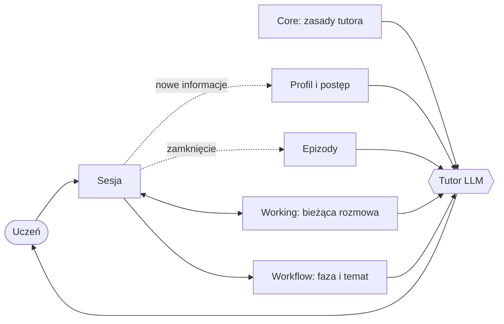

# MyTutorAI

Backend tutora języka angielskiego, który prowadzi ucznia przez wiele sesji i pamięta, co działo
się w poprzednich. Projekt jest skierowany do dorosłych, także początkujących, którzy chcą
swobodniej mówić po angielsku w codziennych sytuacjach w pracy.

## Dlaczego

Zwykły czat z modelem językowym nie nadaje się do regularnej nauki. Każda rozmowa zaczyna się od
zera, więc uczeń za każdym razem opisuje swój poziom, cel i sytuację w pracy. Nikt nie wraca do
zadania domowego ani do błędów, które powtarzają się od kilku tygodni. Model chętnie pisze za
ucznia gotowy tekst, co rozwiązuje bieżący problem, ale nie uczy.

MyTutorAI działa jak lektor, który prowadzi notatki. Po każdej sesji zapisuje, co było ćwiczone,
jakie błędy się pojawiły i od czego zacząć następnym razem. Z rozmów buduje też profil ucznia
(praca, cele, preferencje, mocne i słabe strony), dzięki któremu ćwiczenia dotyczą sytuacji, w
których uczeń faktycznie używa angielskiego.

## Jak działa sesja

1. Uczeń zaczyna sesję i podaje temat. Tutor wita go, nawiązując do tego, co wie: w pierwszej
   kolejności do zaległego zadania, potem do faktu z życia ucznia, a jeśli nic takiego nie ma,
   do samego tematu.
2. Lekcja przechodzi przez trzy fazy w stałej kolejności: sprawdzenie zadania domowego,
   ćwiczenie, podsumowanie. Faza zmienia się automatycznie po określonej liczbie wymian i nie
   można wrócić do poprzedniej. Jeśli uczeń nie ma zaległości, sesja zaczyna się od ćwiczenia.
3. Po zakończeniu rozmowy sesja jest streszczana do epizodu (podsumowanie, popełnione błędy z
   poprawkami, następny krok), a profil ucznia uzupełniany o nowe informacje.
4. Kolejna sesja korzysta z tych danych od pierwszej wiadomości.

Przez cały czas obowiązuje jedna zasada: tutor nie rozwiązuje zadań za ucznia. Na prośbę o
gotowy tekst odpowiada pytaniem albo wskazówką.

Przykładowe informacje, które system gromadzi o uczniu:

| Obszar | Przykład |
|---|---|
| Kontekst zawodowy | nowa praca w banku, kolega z Hiszpanii w zespole |
| Preferencje | krótkie zdania, proste słowa, wolne tempo |
| Kontekst osobisty | ma psa, w weekendy jeździ na rowerze |
| Motywacja i blokady | wstydzi się mówić, chce porozmawiać z kolegą bez tłumacza |
| Mocne i słabe strony | dobrze zna słowa związane z pracą, zapomina o końcówce -s w 3. osobie (Present Simple) |
| Postęp | ostatnie błędy, status zadania domowego, temat następnej sesji |

Cele, terminy i preferencje uczeń może wpisać sam. Pozostałe dane system wyciąga z rozmów i
dopisuje do istniejących, bez nadpisywania i bez duplikatów.

## Pamięć ucznia

Pamięć jest podzielona na pięć warstw. Każda ma inny czas życia i trafia do kontekstu tutora w
innej formie.



| Warstwa | Zawartość | Magazyn | Czas życia |
|---|---|---|---|
| Core | tożsamość i zasady tutora | SQL Server | stała |
| Profil i postęp | cele, kontekst, preferencje, mocne i słabe strony, zadanie domowe | SQL Server | trwała, rośnie z każdą sesją |
| Working | pełny zapis bieżącej rozmowy | Redis | tylko w trakcie sesji |
| Epizody | streszczenia zakończonych sesji | SQL Server | trwała |
| Workflow | faza lekcji i temat | SQL Server | do końca sesji |

## Decyzje projektowe

- Model nie dostaje pełnej historii wszystkich rozmów, tylko profil, streszczenia poprzednich
  sesji i zapis bieżącej. Przy kilkunastu sesjach pełna historia byłaby kosztowna i mniej
  czytelna dla modelu.
- Bieżąca rozmowa jest w Redisie, bo jest czytana przy każdej wiadomości i nie musi przetrwać
  dłużej niż sesja. Dane, które mają zostać na dłużej, są w SQL Server.
- Zasada „nie rozwiązuję za ucznia” jest sprawdzana dwukrotnie. Model zgłasza w odpowiedzi, że
  ją zastosował, a niezależny filtr wykrywa w wiadomości ucznia prośby o gotowe rozwiązanie na
  wypadek, gdyby model tego nie zgłosił.
- Fazy lekcji mają stałą kolejność i zaczynają się od zaległości, tak jak lekcja z lektorem.
- Model zawsze odpowiada w ustalonym formacie danych. Jeśli odpowiedź nie pasuje do formatu,
  dostaje kilka prób na poprawkę. Gdy to nie pomoże, API zwraca 502, a nie ogólny błąd serwera.
- Jeśli streszczenie sesji się nie uda, sesja zostaje otwarta i nic nie jest zapisywane, więc
  uczeń może spróbować zamknąć ją ponownie.
- Treść promptów jest w szablonach poza kodem. Zmiana tonu albo zasad tutora nie wymaga zmian w
  aplikacji.
- Każdy użytkownik ma dostęp tylko do swoich danych, a próba odczytu cudzej sesji zwraca 404.
  Treść rozmów nie jest logowana. Refresh token jest wymieniany przy każdym użyciu, a użycie już
  wykorzystanego tokenu unieważnia wszystkie sesje logowania użytkownika.
- Funkcje demonstracyjne są wyłączane w konfiguracji. Wyłączony endpoint zwraca 404, tak jakby
  nie istniał.

## Przykład użycia API

Przykłady zakładają adres `http://localhost:5035`. Poza rejestracją, logowaniem i odświeżaniem
tokenu wszystkie endpointy wymagają nagłówka `Authorization: Bearer <accessToken>`. Odpowiedzi są
skrócone.

Rejestracja i logowanie:

```http
POST /api/auth/register
Content-Type: application/json

{ "email": "anna@example.com", "password": "Passw0rd!", "displayName": "Anna" }
```

Rejestracja zwraca `202 Accepted`, również gdy adres jest już zajęty.

```http
POST /api/auth/login
Content-Type: application/json

{ "email": "anna@example.com", "password": "Passw0rd!" }
```

```json
{
  "userId": "3f2c…",
  "displayName": "Anna",
  "accessToken": "eyJhbGciOi…",
  "accessTokenExpiresAt": "2026-10-27T10:15:00Z",
  "refreshToken": "q8Zt…"
}
```

Ustawienie celu nauki:

```http
PUT /api/profile
Content-Type: application/json

{
  "goals": [{
    "goal": "Talk about my job in English",
    "reason": "I have a new colleague from Spain",
    "targetSituation": "Small talk in the office",
    "successMetric": "Talk for 2 minutes about my work",
    "deadline": "2026-12-31"
  }],
  "workContext": { "stakeholders": ["My colleague", "My boss"] },
  "communicationPreferences": { "preferredFormats": ["short sentences", "easy words"] },
  "preferences": ["slow pace"]
}
```

Rozpoczęcie sesji:

```http
POST /api/sessions
Content-Type: application/json

{ "topic": "My job" }
```

```json
{ "sessionId": "9b1e…", "phase": 1, "startedAt": "2026-10-27T10:00:00Z" }
```

Pole `phase` przyjmuje wartości `0` (sprawdzenie zadania), `1` (ćwiczenie) i `2` (podsumowanie).

Wiadomość, w której uczeń prosi o gotowy tekst:

```http
POST /api/sessions/9b1e…/messages
Content-Type: application/json

{ "message": "Please write it for me." }
```

```json
{
  "reply": "Let's do it together. What is your job?",
  "coreGuardrailUsed": true,
  "coreGuardrailReason": "Student asked for a ready answer",
  "phase": 1,
  "workingMemoryCount": 6
}
```

Zamknięcie sesji:

```http
POST /api/sessions/9b1e…/close
```

```json
{
  "episode": {
    "summary": "Talked about work. Good new words. Some mistakes with he/she.",
    "personalFacts": ["Has a new job in a bank"],
    "mistakes": [{
      "userPhrase": "He work in an office",
      "correction": "He works in an office",
      "rule": "Present Simple: he/she/it + -s"
    }],
    "nextStep": "Write 5 sentences about your colleague"
  },
  "nextOpenPhase": 0
}
```

Następna sesja zacznie się od sprawdzenia zadania (`nextOpenPhase: 0`).

Podgląd pamięci:

```http
GET /api/memory/episodes          # zakończone sesje, od najnowszej
GET /api/memory                   # wszystkie warstwy pamięci
GET /api/memory/prompt-preview    # kontekst tutora, bez wywołania modelu
```

Błędy mają wspólny format (Problem Details):

| Kod | Znaczenie |
|---|---|
| 400 | niepoprawne dane, z błędami przypisanymi do pól |
| 401 | brak lub nieważny token |
| 404 | zasób nie istnieje albo należy do innego użytkownika |
| 409 | sesja jest już zamknięta albo nie ma w niej żadnej wymiany |
| 429 | przekroczony limit zapytań |
| 502 | błąd modelu językowego |

## Uruchomienie lokalne

Wymagania: .NET 10 SDK, SQL Server, Redis.

Wymaganą konfigurację podaje się przez user-secrets albo zmienne środowiskowe. Bez niej aplikacja
nie wystartuje:

| Klucz | Znaczenie |
|---|---|
| `Jwt:SigningKey` | klucz podpisu, co najmniej 32 znaki |
| `Llm:ApiKey`, `Llm:Model` | klucz API i nazwa modelu |
| `Persistence:SqlServer:ConnectionString` | połączenie z SQL Server |
| `Redis:ConnectionString` | połączenie z Redisem |

W zmiennych środowiskowych dwukropek zastępuje się podwójnym podkreślnikiem, np.
`Jwt__SigningKey`.

`Jwt:Issuer` i `Jwt:Audience` dla środowiska Development są w `appsettings.Development.json`. Poza
nim też są wymagane. Wzór pełnej konfiguracji jest w `src/MyTutorAI.Api/appsettings.Example.json`.
Wartości z tabeli są w nim puste i nie należy ich tam wpisywać. Każdą ustawia się osobno, np.:

```powershell
dotnet user-secrets set "Jwt:SigningKey" "<co najmniej 32 znaki>" --project src/MyTutorAI.Api
```

Frontend uruchomiony lokalnie musi być na liście `Cors:AllowedOrigins` (adresy podaje się bez
ukośnika na końcu, np. `Cors:AllowedOrigins:0` = `http://localhost:5173`), inaczej przeglądarka
zablokuje jego zapytania.

Schemat bazy trzeba założyć przed pierwszym uruchomieniem. Polecenie wymaga narzędzia `dotnet-ef`:

```powershell
dotnet ef database update --project src/MyTutorAI.Infrastructure --startup-project src/MyTutorAI.Api
```

Uruchomienie aplikacji i testów:

```powershell
dotnet run --project src/MyTutorAI.Api
dotnet test
```

Po uruchomieniu API można testować w Swagger UI pod adresem `http://localhost:5035/swagger`
(tylko w środowisku Development).
